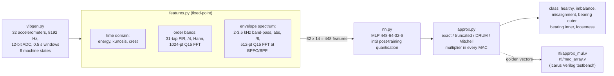
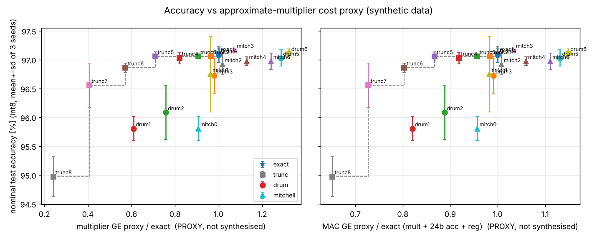
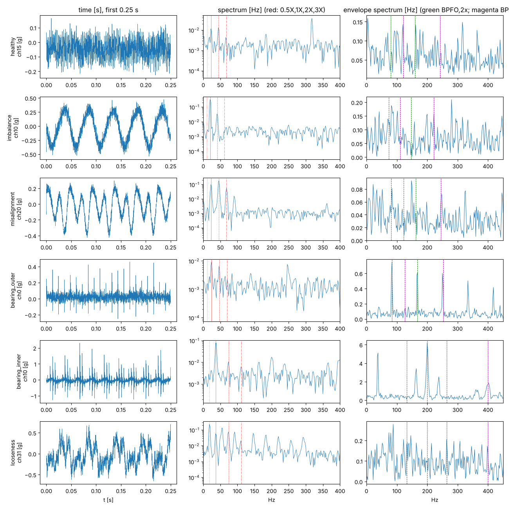
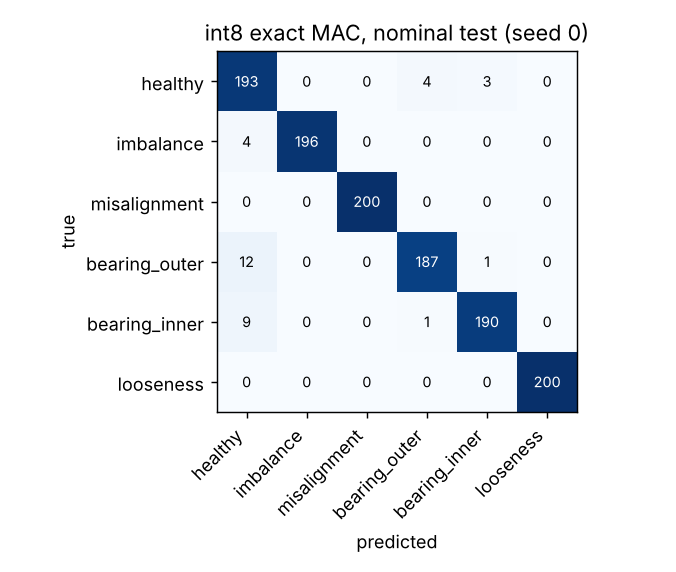
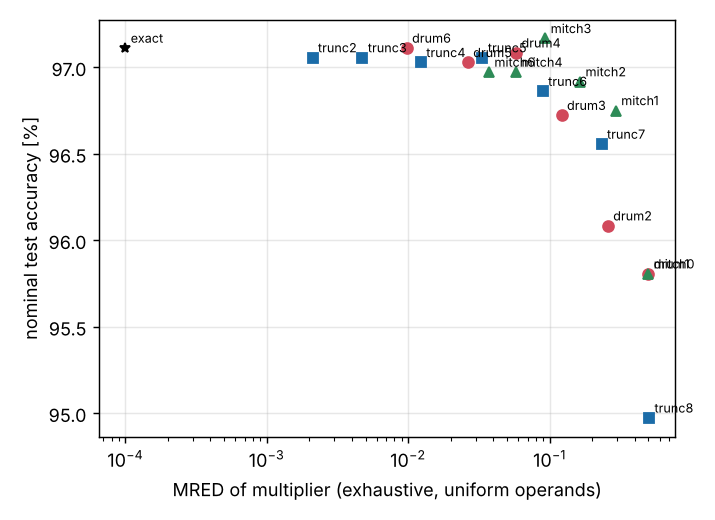

# PolarFire-VibMonitor

> **Archived 2026-11-23.** Why: the project stopped before the FPGA stage. Nothing here was synthesised for,
> placed on or measured on a PolarFire device; it is a software model on synthetic data with a small
> simulated RTL block. This repository is not maintained, and the roadmap below is not scheduled.

[](https://github.com/Kavin-Re/PolarFire-VibMonitor/actions/workflows/ci.yml)


**A feasibility study for a 32-channel vibration-fault classifier aimed at a Microchip PolarFire FPGA, asking one
question: how much multiplier accuracy can the neural-network MAC give up before classification suffers?**

The repository contains a bit-true software model of the whole pipeline (synthetic sensor data → fixed-point features
→ int8 MLP → approximate multipliers) and a small, simulated RTL block for the approximate MAC.

> **Read this first.** Everything here is simulation on synthetic data. Nothing has been synthesised for, placed on,
> or measured on a PolarFire device. There are no LUT, math-block, timing or power figures in this repository, and
> the "cost" numbers are a gate-equivalent proxy with assumed unit costs. The name states the intended target, not a
> result.

## Pipeline



| Stage | File | What it models |
|---|---|---|
| Synthetic machine | `vibgen.py` | Shaft speed 20-38 Hz with ramp and wobble, 6205-like bearing orders (BPFO 3.585X, BPFI 5.415X), distance-based coupling between channels, crosstalk, gain/offset errors, drift, dropout, mains pickup and benign impacts as confounders |
| Features | `features.py` | Integer pipeline (Q15 FIR taps and window, radix-2 FFT with per-stage scaling and int16 saturation, Mitchell-style log2) plus a floating-point reference with the same scaling |
| Classifier | `nn.py` | NumPy-only MLP with Adam, int8/int16 post-training quantisation, integer inference with a pluggable multiplier look-up table |
| Multipliers | `approx.py` | Exact, truncated with constant compensation, DRUM-k, Mitchell; exhaustive error metrics; gate-equivalent cost proxy |
| Experiments | `build_data.py`, `run_experiments.py`, `figures.py`, `make_results_md.py` | Dataset build, training, sweep, figures, and the generated report [`RESULTS.md`](RESULTS.md) |
| RTL | `rtl/` | `approx_mul.v` (exact / truncated / DRUM), `mac_array.v` (parallel MAC lanes), self-checking testbench and vector generator |

## Results (synthetic data, software model)

All numbers come from [`results.json`](results.json) and are explained in full, with every modelling assumption, in
[`RESULTS.md`](RESULTS.md). Accuracy is the mean over 3 training seeds on the same dataset.

| Test set | Windows | float | int8 | int16 | 95% sampling CI |
|---|---|---|---|---|---|
| nominal | 1200 | 97.03% | 97.11% | 97.03% | ±1.0 pt |
| noise ×2.5 | 600 | 77.06% | 77.11% | 77.06% | ±3.4 pt |
| heavy dropout / drift | 600 | 90.56% | 90.44% | 90.56% | ±2.3 pt |
| weak faults | 600 | 82.11% | 82.06% | 82.11% | ±3.1 pt |

Model: 31,014 parameters, 30,912 multiply-accumulates per inference. Train and test windows come from the same
generator with different seeds, so these figures are optimistic and say nothing about a real machine.

Approximate multipliers applied to every MAC of the int8 network (selection; the full 20-design table is in
`RESULTS.md`):

| Multiplier | Mean relative error (MRED) | Multiplier cost proxy vs exact | Nominal accuracy |
|---|---|---|---|
| exact | 0 | 1.00 | 97.11% |
| truncated, k=4 | 0.012 | 0.82 | 97.03% |
| truncated, k=6 | 0.090 | 0.57 | 96.86% |
| truncated, k=7 | 0.233 | 0.41 | 96.56% |
| truncated, k=8 | 0.505 | 0.24 | 94.97% |
| DRUM-4 | 0.058 | 1.00 | 97.08% |
| DRUM-3 | 0.122 | 0.98 | 96.72% |
| Mitchell, F=3 | 0.093 | 1.07 | 97.17% |



What the data support:

- **Accuracy is tolerant of multiplier error.** Up to roughly MRED 0.1 to 0.25 the loss on the nominal set is smaller
  than the ±1 point sampling interval; a clear drop only appears around MRED 0.5. The stressed sets degrade first.
- **Under this proxy, only truncation reduces cost at 7-bit magnitudes.** DRUM and Mitchell need leading-one
  detectors and shifters that cost about as much as the 7×7 array they replace.
- **The network is a small part of the arithmetic.** Per 0.5 s window the front end performs about 5.08 M FIR MACs
  and 0.95 M FFT multiplies; the network's 30,912 MACs are 0.51% of all multiplications. Approximating the network
  alone cannot change the system total by more than that share. The front end was not approximated in this study.
- **Fixed-point features are close enough.** Feeding floating-point reference features to the model trained on
  fixed-point features gives the same 97.17% (seed 0) on the nominal set.

What they do not support: any statement about PolarFire resources, speed or power, and any statement about real
vibration data. On PolarFire an 8×8 multiply would probably map to a hard math block, where truncation saves
nothing; that has to be checked by synthesis.

<details><summary>More figures</summary>

Example windows from the generator, one per class (time signal, spectrum, envelope spectrum):






</details>

## RTL

`rtl/approx_mul.v` is a combinational signed 8×8 multiplier in sign-magnitude form with three modes selected by
parameter (exact, truncated-K with gated constant compensation, DRUM-K). `rtl/mac_array.v` instantiates `LANES` of
them sharing one broadcast activation, each with a 24-bit accumulator: `acc <= (clear ? bias : acc) + x*w`.

Verification status:

| Check | Tool | Result | Where |
|---|---|---|---|
| RTL equals the Python model: 65,025 operand pairs × 5 designs, plus 12 dot-product trials × 3 designs × 8 lanes | Icarus Verilog 12.0 | `TB PASS: 325161 checks, 0 errors` (recorded by the author) | `rtl/sim.log`, re-run in CI |
| Golden vectors equal an independent integer re-implementation of both the model and the Verilog semantics | Python standard library | 8 tests pass | `tests/test_rtl_vectors.py` |
| Generic gate count of the 8-lane array (technology-independent cells, **not** PolarFire LUTs) | Yosys `synth` | exact 4883, truncated-6 4055, DRUM-4 6279 cells (recorded by the author) | `rtl/sim_status.txt` |

Limits of the RTL: operands must be in [-127, 127] (−128 has no sign-magnitude form; the quantiser clips to ±127);
no saturation; no layer sequencing, weight memory, requantisation stage or feature front end; Mitchell is not
implemented. It is a verified arithmetic block, not a design that can be put on a board.

## Reproducing

```bash
pip install -r requirements.txt            # numpy, matplotlib

python3 -m unittest discover -s tests -v   # 32 tests; tests/test_rtl_vectors.py needs no numpy

python3 build_data.py                      # synthetic datasets -> data/*.npz (about 6 minutes on 2 cores)
python3 run_experiments.py                 # train, quantise, sweep -> results.json, figures/, data/qmodel_int8.npz
python3 figures.py                         # generator illustration figures
python3 make_results_md.py                 # results.json -> RESULTS.md

rtl/run_sim.sh                             # needs iverilog; regenerates vectors, runs the testbench, fails unless TB PASS
```

The feature datasets are not committed (they are rebuilt deterministically from fixed seeds). The quantised seed-0
model `data/qmodel_int8.npz` is committed because the RTL vector generator uses a slice of it.

## Repository layout

```
vibgen.py            synthetic 32-channel vibration generator
features.py          fixed-point and reference feature extraction
nn.py                MLP, quantisation, integer inference
approx.py            approximate multipliers, error metrics, cost proxy
dataset.py           dataset build / cache        build_data.py   builds all five sets
run_experiments.py   training + sweep             figures.py, make_results_md.py
results.json         raw results                  RESULTS.md      generated report
figures/             plots used above
data/qmodel_int8.npz quantised seed-0 model (weights, biases, one input row, standardiser)
rtl/                 approx_mul.v, mac_array.v, tb_mac_array.v, gen_vectors.py, run_sim.sh, vectors/
tests/               unittest suites
```

## Limitations

- Synthetic data from one generator for both training and test; no real machine, no public bearing dataset.
- Three training seeds on a single dataset; test sets of 600 to 1200 windows, so differences below about 1 to 3
  points are noise.
- One fault per window; no combined faults, fault progression, unseen-fault detection or false-alarm analysis.
- A tachometer speed estimate (0.3% error) is assumed; order bands depend on it.
- RMS, kurtosis and crest factor use a floating-point square root and divide on integer sums; a hardware divider is
  not modelled.
- The cost proxy uses assumed gate-equivalent unit costs and was not validated by synthesis.
- No approximation-aware retraining; models are trained exactly and then quantised.

## Roadmap

1. Synthesise `mac_array` for a PolarFire part in Libero SoC and replace the proxy with LUT / math-block counts
   and timing. `TODO(verify on hardware)`
2. Evaluate on a public bearing dataset (for example CWRU or Paderborn) instead of synthetic data only.
3. Extend the approximation study to the FIR and FFT front end, which holds over 99% of the multiplies.
4. Add the missing RTL: layer sequencer, weight ROM, requantisation, and a fixed-point feature front end.
5. Approximation-aware fine-tuning for the aggressive designs.

## License

Copyright 2026 Kavin K K. Licensed under the [Apache License, Version 2.0](LICENSE); see also [NOTICE](NOTICE).
